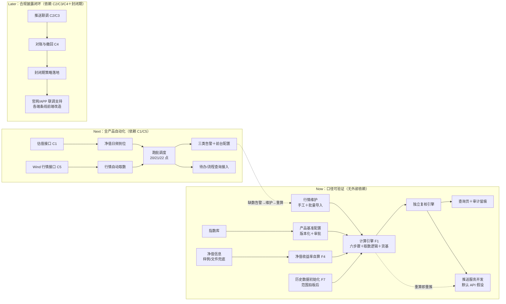

# 业绩比较基准管理系统 实施规划：优先级与路线图 v0.1

> 状态：草稿·待评审　日期：2026-11-24　配套：`业绩比较基准管理系统_PRD_v0.1.md`（功能编号 F1–F7、Must/Should 清单见 PRD §3.1）
> 容量假设：〔缺数据：开发团队规模与人月容量〕——本文只排**顺序与分期**，不承诺人月与日期；排期＝开发评估 × 1.5–2 风险系数，跨团队依赖（C1/C2/C4/C5、下游前端）单列不计入功能工期。

## 一、框架选择：为什么不用 RICE 打分

本项目是**合规硬约束**（监管 2027-03-01 硬时限，Q44 要求 2027-01 前完成全量改造），"做不做"不由分数决定——RICE 会掩盖非对称收益与硬约束。且 Reach 需要用户/产品只数数据〔缺数据〕，无上下文时打分是假精确。

故采用：**MoSCoW 定范围（PRD §3.1 已定）＋依赖驱动分期（Now/Next/Later）**。排序的意义是暴露"哪些能立即动工、哪些卡在外部定夺"，而不是给监管链路排优先级分数。

## 二、依赖图

关键链：**指数库 → 基准配置 → 计算引擎 → 复核 → 推送**。净值接口（C1）与行情接口（C5）是自动化的两个外部闸门；历史回补（F7）是累计连乘与追溯重算的隐含前置。推送服务**开发**可在 Now 按默认假设先行，**联调**卡在 C2/C3/C4——开发与联调分离，避免外部定夺延迟阻塞内部进度。

## 三、Now / Next / Later（按目标组织）

### Now — 目标：单基金全链路可算、可验、可查

不依赖任何外部定夺即可动工（净值用 000270 样例/文件兜底，行情用手工维护＋批量导入）。

| 功能 | 对应 PRD | 为什么现在 |
|------|---------|-----------|
| 指数库、产品基准配置（版本化＋审批＋追溯重算） | F2 | 计算引擎的前置主数据 |
| 行情查询/维护（手工多行＋批量导入＋维护记录） | F3 | 缺数兜底与修订重推的入口 |
| 计算引擎六步骤＋取数逻辑（七类×六情形）＋货基口径 | F1 | 监管风险的核心是口径正确，最早验证 |
| 净值收益率自算（分红/折算还原＋30 位精度） | F4 | 样例数据已备，可先于接口开发 |
| 独立复核引擎、查询页（异常链路）、审计留痕 | F1/UC-01/G4 | 与引擎同步交付，验证闭环 |
| 历史数据初始化与回补 | F7 | **范围拍板后**立即启动（回补周期长，晚启动压缩后续窗口） |
| 推送服务开发（默认 API＋批次号对账〔假设〕） | F5 | 开发与联调分离，C2 定夺后仅切换适配层 |

**退出标准**：000270 全期 1703 行逐位吻合（基准累计 57.2573% / 净值累计 75.986795%）；VBA 2026-06-30 参考样本抽验通过（避开第 5 成分权重缺陷）；七类构成×六情形回归全过；2028 闰年、季末非交易日、节假日合并、美股 T+1 边界单测全过；权重≠100% 阻断、缺数隔离、重算即重推（含零差异）用例通过。

### Next — 目标：全产品日频跑批自动化、告警闭环

依赖 C1（估值接口落地验证）、C5（Wind 对接方式）收口。

| 功能 | 对应 PRD | 闸门 |
|------|---------|------|
| 估值接口对接（净值信息日频、A/C 独立、修订通知） | F4/C1 | 估值侧已反馈可解决，待接口验证 |
| Wind 行情接口对接（含模板维护与格式变更通知） | F1/C5 | 技术对接会当场收口 |
| 跑批调度（20 点首跑/21 点告警/22 点二跑）＋齐套检查全产品化 | UC-08 | 接口到位＋窗口压测 |
| 三类告警通知＋收件人/预警时间前台配置 | F6 | 配置屏载体设计〔待确认〕 |
| 待办/流程查询接入 | §5.2 | 平台通用能力 |
| 全量历史回补完成 | F7 | 数据源可得性验证 |

**退出标准**：全产品规模下批次在 20→22 点窗口内完成〔假设：待压测〕；缺数基金隔离不阻塞整批验证；告警漏报＝0；估值修订→影响评估→重算→重推全链路留痕。

### Later — 目标：监管合规披露闭环（2027-01 前）

依赖 C2/C3/C4（官网/APP 侧＋业务老师）与封闭期方案定夺；下游前端改造由各端条线负责（Q44），本项目边界至推送＋联调支持。

| 功能 | 对应 PRD | 闸门 |
|------|---------|------|
| 推送联调（方式/频率/时限按定夺切换适配层） | F5/C2/C3 | C2 若 2026-12-11 无回复按预案催办（须本人通知） |
| 对账与差错撤回（批次号/记录数/回执） | F5/C4 | 与官网/APP 侧定 |
| 封闭期披露策略落地 | F5 | 2026-12-31 前未定暂按「随估值日报标签披露」〔待定〕 |
| 官网/APP 联调支持＋清盘移出验证 | UC-09 | 各端条线进度 |

**退出标准**：官网＋APP 同源同批次；重算即重推（无差异门槛）端到端验证；清盘按公告日移出、历史归档可查；**2027-01 前全量改造完成**（Q44，预留 2 个月缓冲至监管 2027-03-01）。

## 四、切割线与取舍

- **现在做**：Now 全部（Must 核心链路＋推送开发）——监管风险在口径正确性，最早验证口径等于最早消除最大风险。
- **下一批**：Next（接口＋调度＋告警）；Should 中批量导入已并入 Now（回补效率依赖），告警前台配置与待办接入在 Next。
- **暂缓/不做**：Won't 清单（PRD §3.3：区间指标推送、波动率、差值、文案、微信、定期报告导出、新老并行、VBA 下线、基准点位）；Could 区间汇总能力随引擎保留、不单独排期、不推送。

**取舍代价（命名）**：选"先单基金口径验证、再全产品自动化、后推送联调"，换来口径风险最早出清；代价是推送联调被压到 Later 窗口——若 C2/C4 定夺拖延，将侵蚀 2027-01 前的 2 个月缓冲。缓解：推送开发在 Now 按默认假设先行，联调只做适配层切换；C2 催办预案已备（触发须本人通知）。

## 五、里程碑锚点（仅已定夺日期，不虚构排期）

| 日期 | 里程碑 | 来源 |
|------|--------|------|
| 〔待确认〕 | 开发启动（前提：PRD 附录 8.2 冲突①②③⑧拍板归零＋容量评估） | 本规划 |
| 2026-12-11 | C2 无回复则催办预案触发（须本人通知，不自动执行） | 决策待办清单 |
| 2026-12-31 | 封闭期方案定夺截止（未定按预案〔待定〕推进） | 决策待办清单 |
| 2027-01 | 全量改造完成（含推送联调，预留缓冲） | Q44 业务定稿 |
| 2027-03-01 | 监管硬时限（指引过渡期截止） | 指引第十六条 |

## 六、前提与缺口

- 本排序不包含：开发容量〔缺数据〕、跨团队依赖工期（C1/C2/C4/C5、下游前端）、政治因素。
- 信心低于 50% 的项：跑批窗口时长（全产品规模未知）、历史回补可得性——先补证据再排期，不据此承诺日期。
- F7 历史回补范围未拍板前，Now 的"累计连乘起点正确"退出标准无法对全量产品成立——**开发启动前必须收口**（PRD §7.2）。
- 告警前台配置屏原型未承载，Next 启动前须补设计。

---

**已定决策**：MoSCoW＋依赖分期（不用 RICE）；Now 口径验证→Next 自动化→Later 披露闭环；推送开发与联调分离；里程碑锚 Q44 2027-01 与监管 2027-03-01。
**待验证假设**：API 推送默认、跑批窗口、历史回补可得性（同 PRD §7.1）。
**下一步**：①冲突①②③⑧＋F7 范围拍板（开发启动闸门）；②C1/C5 半页核对单带下次技术对接会；③容量评估后按本分期排期（×1.5–2 风险系数）。