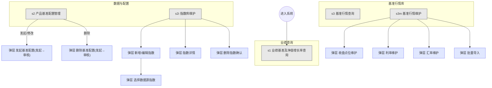

# 屏幕地图（Master Screen Map）— 业绩比较基准管理系统

导航三组五屏；弹层就近挂载于所属主屏。

| 主屏 | 定位 | 关联用例 |
|------|------|----------|
| s1 业绩基准及净值增长率查询 | 结果消费（只读＋导出） | UC-001 |
| s2 产品基准配置管理 | 配置版本管理入口 | UC-003/004/005 |
| s2i 指数库维护 | 主数据维护（Wind 编码唯一键） | UC-002 |
| s3 基准行情查询 | 行情消费（只读） | UC-006 |
| s3m 基准行情维护 | 行情采集入口（发起→审核） | UC-007 |
