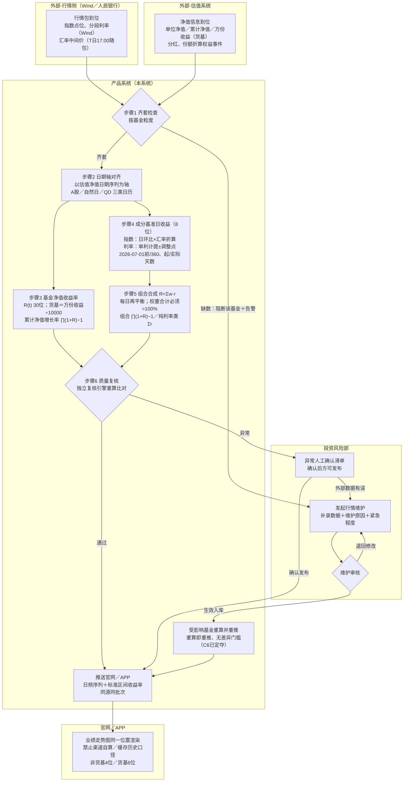

# 业绩比较基准项目——每日计算与披露主流程图

> 依据《业绩比较基准收益率统一计算与披露业务解决方案》**v2.7** §3.1/§3.2（六步骤）、§5.2（通知）、§5.3（推送）、§5.4（异常处理）绘制。
> 性质：**to-be 流程**（系统尚未上线）。各阶段无实测时长，P50/P90 一律记 0，本图只表达**结构与责任归属**；未做 cycle-time / bottleneck 分析（process-mapper 前提：无实测数据时分析无意义）。上线后可用跑批日志回填时长，再跑 `cycle_time_analyzer.py` / `bottleneck_detector.py`。
>
> 配套文件：[泳道图（process-mapper 产物）](每日计算与披露流程-swimlane.md) ｜ [流程 JSON](每日计算与披露流程.json) ｜ [规范化 JSON](每日计算与披露流程-normalized.json)

## 一、主流程（含闸门与返工回路）

**读图要点**

- 两条外部数据腿（行情侧／估值系统）独立到位、独立告警（收件人不同，见下表），在**齐套检查**汇合；缺数按基金粒度隔离，不阻塞整批。
- 步骤3（基金侧）与步骤4→5（基准侧）是**并行计算腿**：基金侧累计连乘 ∏(1+R)−1；基准侧组合连乘、纯固定利率类逐日算术加总 Σr（口径详见解决方案 §4.2.2）。
- 复核三层：数据层（缺行情阻断＋告警）、计算层（独立引擎同公式重算比对）、业务层（异常人工确认清单）。
- 返工回路两个触发源：**缺行情告警**／**发现外部数据有误**；维护审核通过生效入库后，受影响基金自动重算并**重算即重推**（2026-11-23 C6 定夺，无论有无差异、不设 0.01pp 门槛）。

## 二、时点锚与告警分支（时间触发，非线性阶段）

| 时点 | 规则 | 收件人（前台可配置） | 出处 |
|---|---|---|---|
| T 日 17:00 | 汇率中间价随行情包到位 | — | §5.1 |
| 20:00 | 首次跑批（暂定） | — | §5.2 备注 |
| 21:00 | 首次告警：未获取指数点位/利率/汇率 | 投资风险部＋金科 | §5.2 行1 |
| 21:00 | 首次告警：未获取净值信息 | FA＋金科 | §5.2 行3 |
| 22:00 | 二次跑批；跑批后统一告警：未到达指数＋未生成结果 | 投资风险部＋金科＋网金 | §5.2 行2 |
| T+1 | 含美股成分的基准 T+1 出具（等美股 T 日收盘，北京时间 T+1 凌晨） | — | 取数逻辑文档 S6 定夺 |

**特殊批次**：周频/月频/QDII 按各自披露日随批推送；封闭期产品按其净值披露频率推送（披露方案二选一**待定夺**）；清盘基金按清盘公告日移出推送、历史归档可查。

## 三、上游与按需子流程（本图未展开，另行映射）

1. **指数库配置**：成分基准主数据（编码/类型/来源/外盘币种），投资风险部维护；删除有在用引用校验。
2. **产品基准配置**：经办发起→审核→版本化生效（新版生效旧版自动截断）；权重合计≠100% 阻断提交。
3. **基准变更追溯重算**（§5.4）：历史区间按旧版本计算→触发追溯重算评估→重推受影响数据；过合同生效日未配置的自动补算。
4. **行情维护流程**（§3.1 第6条）：即主图返工回路，可单独展开为含待办/流程查询的审批泳道图。

## 四、开口项（影响流程落地）

- C1 估值对接方式（估值侧已反馈可解决，待接口落地验证）
- C2/C3/C4 推送方式/频率时限/对账撤回（待相关部门回复）
- C5 Wind 行情对接方式（接口 or 文件）
- 封闭期披露方案二选一（内部讨论中）